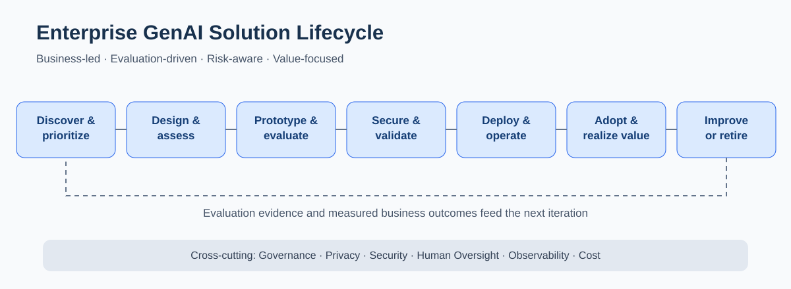

# Enterprise AI Delivery & Governance Frameworks

Practical frameworks for taking AI opportunities from business discovery through architecture, evaluation, production readiness, adoption, and measurable outcomes.

This is a **technology leadership and solution-delivery portfolio**, not a collection of production application source code. The frameworks are illustrative, vendor-neutral, and do not describe confidential employer or client implementations.

## Featured frameworks

### Predictive ML Thin-Slice Delivery Model

My original framework for coordinating predictive ML experimentation with early API/UI integration, product feedback, and operational readiness.

**1. Initiate:** Establish business goals, success measures, architecture, data readiness, risks, delivery roadmap, and shared ownership across engineering, product, data science, and compliance.

**2. Experiment with early integration:** Evaluate model candidates, test business scenarios, connect outputs to APIs and user workflows, and run iterative A/B or side-by-side comparisons. Validate the product experience alongside model performance.

**3. Prepare for production:** Confirm model selection, harden integrations, complete security/privacy reviews, establish monitoring and operational ownership, and plan deployment and maintenance.

The model illustrates how teams can shorten feedback cycles without treating model accuracy as the only measure of success.

### [Enterprise GenAI Solution Lifecycle](docs/enterprise-genai-lifecycle.md)

A complementary framework for LLM applications, retrieval-augmented generation (RAG), agent-enabled workflows, and enterprise AI integrations. It emphasizes choosing appropriate technical approaches, evidence-based evaluation, security, human oversight, and business value realization.

## Principles

- **Start with the business workflow.** Define outcomes, baseline measures, and the problem before choosing an AI technology.
- **Use the simplest suitable architecture.** Consider deterministic software, search, predictive ML, RAG, LLMs, agents, and human review based on need and risk.
- **Evaluate probabilistic behavior.** Test representative questions and failure cases; measure retrieval coverage, groundedness, quality, and tool reliability.
- **Design for enterprise operation.** Plan identity, permissions, integrations, monitoring, latency, cost, incident handling, and ownership.
- **Apply proportionate governance.** Address privacy, security, auditability, and human approval according to risk.
- **Measure realized value.** Distinguish adoption from effectiveness, workflow improvement, and financial return.

## About

My background spans hands-on software development and solution architecture (C#, .NET, Java), enterprise AI/ML product delivery, and cross-functional AI transformation leadership. Recent work involves oversight of GenAI initiatives with APIs, RAG, agentic capabilities, and Python-based AWS Lambda integrations, alongside architecture, evaluation, governance, and adoption collaboration.

These assets describe **generalized methods**, not any employer's proprietary processes, code, datasets, or architecture.

## Usage

These reference materials are for professional discussion and learning. Adapt controls and acceptance criteria to the specific application's risk, regulatory context, and operating environment.
